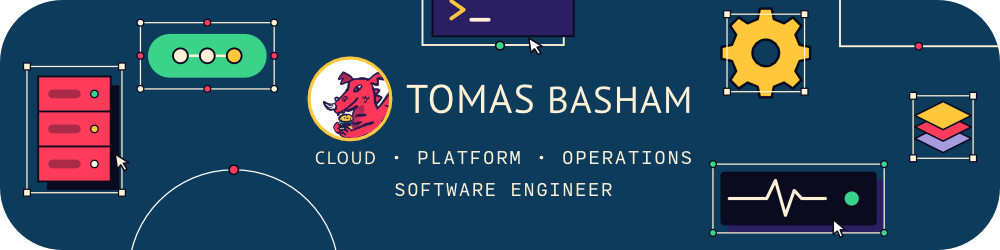

  

  # Tomas Basham
  ### **Cloud, Platform and Operations engineer**

  
  
  
  

# About Me

I'm a software engineer at StatusCake, where I work on the platform that watches
other people's websites so they don't have to.

I started out writing backend services and have gradually moved down the stack
towards the things those services run on. My job title says one thing; my week
usually says four. What ties them together is an interest in how software
behaves once it's in production: how it's deployed, how it fails, and how
quickly someone finds out.
